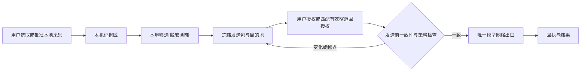

# OShell AI 助手改进方案 v2

状态：分阶段实现；第一阶段发送授权已进入工作区，验证记录见本机 validation/ai-authorization-checks.json。评估日期：2026-10-23。

基于 `3f4efd9` 之后当前工作区的 AI 首版代码，而不是仅依据 0.2.92 已发布安装包。原设计交付是现状评估、产品与安全设计、实施顺序和验收标准。当前仅实现一次请求的逐项发送授权、冻结请求、派生资料撤回与统一出口；下文的任务内复用许可、图像编辑、组织策略、受控执行、长任务记忆等仍为规划，不代表已经实现。

## 1. 定位和关键决定

把 AI 助手升级为**围绕具体任务组织证据、提出下一步、帮助完成验证的开发运维工作台**。

用户需要得到三种收益：临时问题随手解决；复杂问题有连续的排查路径；成功经验能复用。智能程度应体现在定位相关证据、减少无效操作、及时发现前提不成立，而不是收集更多数据或扩大自动执行权限。

建议确定以下产品原则：

1. “终端里看得到”不等于“允许发给模型”。本机显示的真实服务器、账号、目录可服务于操作者，默认不进入 AI 请求。
2. 明确区分**为 AI 读取资料、发送给某个模型服务、执行操作、持久保存/导出**四种权限。
3. 只有应用程序的授权检查能放行请求。模型、日志、源码注释、工具响应和提示词不能授予权限。
4. 一次明确的用户操作可以完成授权并发送，已批准的同一快照无需反复弹窗；新增范围、接收方或内容变化不能隐式继承授权。
5. 人的任务可以持续，执行目标必须严格绑定。切换目录不应直接丢失思考过程，重连也不能让旧命令获得新连接的执行资格。
6. 事实、假设、建议、实际执行结果和验证结论必须分开显示。

## 2. 当前实现的评估

### 2.1 已经具备的基础

当前已有右侧面板、独立窗口、三种提问入口、主动添加文本/图片/文件、发送预览、停止生成、分屏独立对话和后台回复提示。命令支持复制、保存为快速命令及受限填入；填入不回车、不广播，并核对会话绑定及空闲提示符。服务默认未配置，非回环 HTTP 被拒绝，请求不跟随重定向，网络缓存/凭据缓存关闭，响应大小和超时有边界。

API 配置和可选历史通过本机独立密钥加密保存，没有加入 OShell / oshell-desktop 共享配置。应保留这些能力，尤其是目标绑定、拒绝重定向以及无法确认终端状态时降级为复制的行为。

已复核现有原生界面截图 `validation/ui-ai-assistant.light.png`（本地模拟回复）。命令卡片与三种入口较清楚，但顶部两排管理按钮、历史附件全文占用较多空间；发送按钮旁没有接收端和范围摘要，也缺少持续可见的任务阶段与证据来源。下一版把低频管理操作收进菜单，证据默认折叠，保留最小下一步和发送摘要在视线内。这是界面评审观察，尚非真实用户可用性测试结论。

### 2.2 按用户目标评价

| 维度 | 当前能做到 | 主要缺口 | 改进方向 |
| --- | --- | --- | --- |
| 易用 | 有明显入口和快捷键，配置后可开始问答 | 完整 API 地址、模型能力、上下文限制需要用户自行理解；发送的资料范围不够直观 | 接入向导、任务入口、始终可见的发送摘要 |
| 好用 | 能解释已有错误并生成命令 | 主要依赖用户描述和复制输出；缺少证据引用、判断依据和结果验证 | 证据卡、待验证假设、下一步与验证卡 |
| 便捷 | 支持上下文附件和命令按钮 | 任意追加输出、重新建立对话、整理历史仍靠人工；没有命令块级工作流 | 最后一次失败命令、指定命令结果快照、任务持续、可复用流程 |
| 智能 | 能利用给定文字和图片 | 不知道缺少什么、是否已经验证、何时应停止猜测；未用真实模型评测 | 先列所需证据、按需请求、可证伪的分支计划 |
| 运维 | SSH、服务报错、日志解释适合现有基础 | 环境边界、检查成本、权限、实际连接目标与修复验证还未形成完整任务流 | 服务/网络/磁盘/容器排障方案和受控检查 |
| 研发 | 能解释命令、粘贴构建错误和源码片段 | 没有项目级资料选择、Git diff、测试与补丁评审流程 | 构建/测试故障、变更解释、最小补丁与验证 |
| 数据授权 | 可以预览和手动添加附件 | 自动附加元数据、重发历史及图片；没有绑定最终请求的授权记录 | 默认最小化、逐项范围、不可变发送包、统一发送检查 |
| 本机安全与可靠性 | 本机加密、请求取消、错误保留草稿 | 同目录本机密钥不等于硬件级防窃取；取消不等于服务端撤回；删除及重试语义需更清晰 | 明确保护边界、密钥模式、发送记录、可控保留策略 |

这里是基于实现的定性评估，不是用户体验打分或效率提升实测。真实服务、企业数据和研发/运维任务质量尚需经过批准的试点验证。

### 2.3 必须优先处理的授权缺口

| 编号 | 当前证据 | 风险/限制 | 方案要求 |
| --- | --- | --- | --- |
| F1 · P0 | `AIService.swift` 的 `AIRequest.make` 无条件加入 `target.metadata`；`TerminalPane.aiTarget` 使用完整 `connectionDetails` | 用户只问通用命令，也会附带主机、用户、IP、代理信息或目录；不符合字段级、明确范围的新目标 | 默认不发送这些字段；按任务逐项选择，支持匿名环境摘要 |
| F2 · P0 | `AIAssistantSession.prepared` 使用全部 `messages`；`AIRequest.make` 遍历所有历史图片 | 后续一句“继续”可能重发旧附件文字和图片；从当前附件区移除不等于排除历史副本 | 所有实际发送的历史及图片进入发送清单，可从后续上下文撤回 |
| F3 · P0 | `previewRequest` 和 `sendPrompt` 各自重新构造请求；预览是独立可选按钮 | 无法证明“审阅/批准的内容”等于“真正发送的内容”；元数据或模型配置可能发生变化 | 审阅和发送共用同一个冻结对象，并校验版本、摘要和权限 |
| F4 · P0 | 改服务确认仅比较 `endpointUsed` 与当前 endpoint | 同地址模型/租户/网关路由变化没有明确的接收范围授权 | 绑定服务配置版本、模型和租户/路由声明；未知路由不显示为已验证内网服务 |
| F5 · P0 | `AIPrivacy.clean` 只覆盖有限正则；图片直接按 PNG 数据发送 | 账号、IP、业务标识、源码、图片内信息等不一定命中；脱敏不等于授权 | 脱敏和授权独立检查；图像裁剪/遮盖在本机完成，无法判断时停留本地 |
| F6 · P1 | `AITarget.stamp` 包含目录/主机；`bind` 发现变化就取消并新建会话 | 正常 `cd` 或环境识别更新也可能打断连续排查 | 拆分任务、连接代次、目录及证据版本，保留任务，令相关旧操作失效 |
| F7 · P1 | 字符/消息超限时要求减少附件或新建对话；输出截取以行数/尾部为主 | 可能丢掉错误开头、命令和退出码，用户需要重复搬运信息 | 命令块与证据来源、明确截取边界；按需补充而非默认上传全部 |
| F8 · P1 | 命令通过 shell 代码块识别，风险提示依赖少量字符串模式 | 不能覆盖变量展开、别名、子进程、SQL、工具脚本等行为 | 把风险描述与授权执行分离；不以命令名称或模型自评作为安全凭证 |
| F9 · P1 | `record` 包含原始目标元数据，导出为普通文本；本地凭据密钥与加密记录均在本机目录 | 请求脱敏规则与导出范围不完全一致；加密无法防御已获得当前用户文件访问权的进程 | 导出单独预览；明确文件权限/加密边界，提供更强密钥模式 |

**并未发现或声称已经发生真实数据外泄。** 为核实 F1/F2/F3，使用当前 `AIService.swift` 和已构建 Core 对象，仅序列化合成请求：未添加附件时仍出现合成主机/账号元数据；后续消息重发旧文字和图片；改变模型后重建请求体不同。没有网络调用，没有读取真实会话或密钥。

复核证据在本机 `validation/ai-design-request-evidence.json`，源码摘要在 `validation/ai-design-source-baseline.json`。现有 `ai-first-version-checks.json` 记录的 45 项检查和回环测试仍有价值，但 `requestIncludesExplicitContextOnly` 只检查指定文本与几个敏感标记，**没有验证默认元数据排除、字段授权、历史撤回或预览绑定**；绿色测试不能代替这些验收。该报告同时明确 `externalModelTested: false`。

## 3. 新的交互结构：随手问、任务工作台、经验库

### 3.1 随手问

选中一条命令、一段报错或代码后，提供“解释”“排查”“改写”。短问题在轻量面板直接回答，可转入任务工作台。打开、选择或预览都只在本机发生；只有明确发送才联系所选模型。

通用问题不要求先建立 SSH 连接。默认只包含用户输入和其主动选择的快照，不自动发送主机身份、目录、全屏内容或历史。必要时 AI 提出“还需要系统类型/服务版本”，用户可以手填，也可以批准采集指定信息。

### 3.2 任务工作台

右侧默认约 420 点，可调整或独立打开。保持一个输入框，以“排障 / 开发 / 命令”三个任务入口引导用户，不为每项能力再增加一层设置。每个任务保留目标、证据、假设、操作记录和授权范围。

```text
AI 助手    [排障] [开发] [命令]                   [收起]
任务：Nginx 启动失败                 [历史] [新建任务]
本机目标：生产应用 · ops@真实主机          [变更目标]
AI 接收端：团队模型 / 固定路由 A            [更改]

当前判断：配置校验未通过（有证据）
依据：E1 · 启动日志 · 第 12–16 行             [查看]
尚不确定：是否存在另一处配置错误

下一步：校验指定配置
目标/目录/权限/作用/预计读取范围
[复制] [填入原会话] [申请受控检查]

证据： [E1 日志 80 行 ×] [系统摘要 ×] [添加证据]
本次发送：2 份快照 · 6 KB · 已遮盖 3 处
历史：保留 2 轮；旧图片未附带                 [调整]
不发送：真实主机身份、其他会话、整个项目

[输入问题……]
[预览变更]                  [发送这份内容到团队模型]
```

“本机目标”栏始终为用户显示真实对象；“AI 接收端”和“本次发送”解释哪些信息会离开本机。这两者不能共用一个“已连接”图标。

任务对话不会因单纯改名或 `cd` 消失。切换标签默认切换到对应任务；可显式固定一个任务，但固定后持续显示它绑定的目标，不跟着当前标签暗中改变。重连、内层跳转、连接切换时保留记录，禁止旧操作继续使用新的连接资格。

### 3.3 经验库

把已验证的流程保存为“操作方案”，包含适用条件、参数、检查步骤、影响、验证方法、已知限制和最近验证时间。默认仅本机保存，用户审阅后才可复用；不自动把全量历史、私有源码或终端输出变成长期记忆。

初始模板可覆盖服务启动、磁盘/ inode、端口连通、容器异常、构建失败、测试失败、依赖冲突、Git 变更解释。模板只是提出需要的信息和步骤，不自动获得读取、联网或执行权限。AI 生成但未验证的方案必须标注“草稿”。

## 4. 两类完整工作流程

### 4.1 运维：服务启动失败

1. 用户选中失败输出，选择“排查故障”。本地生成证据 E1，记录来源会话、获取时间、命令/退出码是否已知；尚未联网。
2. 本地处理候选敏感内容，展示修改前后差异。用户选择匿名主机摘要，明确接收端后授权发送 E1。
3. AI 给出“已确认 / 可能原因 / 缺失信息 / 最小下一步”，并引用 E1 的具体行。没有证据时只能说待确认。
4. AI 请求补充配置校验或某段日志，界面显示目标、路径、时间窗、行数和用途。用户可手动运行，也可批准一个受控采集步骤。
5. 输出先落到本机证据区。执行批准不意味着允许上传输出；由用户再选发送，或由此前明确批准的窄范围结构化结果授权覆盖。
6. 如果需要改配置，先展示差异、原文件版本、备份、验证和失败处理。写配置、重启服务分别授权。无法可靠备份/回滚的步骤不得宣称“可一键撤销”。
7. 用授权的检查确认服务状态及用户关心的可用性；明确区分模型建议、操作实际成功、服务健康、业务验证。用户确认后结束任务并整理记录。

磁盘满、网络不通等模板也遵循此流程。不能把“检查一下”解释为自动收集全部日志、环境变量、网络拓扑或数据库内容。

### 4.2 研发：构建或测试失败

1. 从失败的命令块进入“分析构建失败”，默认候选是这一次命令、退出码和相关错误片段；若识别不到命令边界，要求用户选择，不能猜成完整日志。
2. 用户按需要添加依赖清单、选中源码片段或 Git diff。文件范围和实际内容在本机预览；选择项目目录不等于授权上传整个项目。
3. AI 引用错误位置，提出可能的依赖、编译器、配置或代码问题，明确仍需补充的资料。优先请求最小片段，避免反复要求复制全文件。
4. 生成最小补丁，展示完整 diff、受影响路径、前提和建议测试。补丁只是本地候选；应用前核对原文件摘要，文件已变化则重新比较。
5. 测试命令有独立执行授权。构建、测试、包安装可能运行项目脚本、下载依赖或写文件，不能统一标记为“只读安全”。
6. 新结果先保留本机；用户授权发送后继续分析。AI 只能依据真实测试结果声称“通过”，不能把测试命令建议当作验证完成。

Git 使用场景支持解释选定 diff、生成提交说明、审查选中变化。未批准前不全仓索引、不读取未选中的未跟踪文件、不执行仓库脚本、不提交或推送代码。Git 读取适配器应禁用外部 diff、textconv、分页器等可执行扩展，避免“读差异”暗中运行仓库提供的程序。

### 4.3 命令编写与解释

输入目标、范围和限制即可开始。系统类型、Shell、工具版本缺失时，AI 提供可选方案或询问前提，不自动探测。命令卡展示用途、目标、路径、权限、影响和预期结果。复杂/多行脚本先进入可编辑草稿，不直接塞入正在交互的终端。

复制、填入、执行是不同动作。现有“不回车、不广播、已有输入不覆盖”继续保留。无法确认提示符、遇到密码框、vim/top/其他 CLI Agent 或内层 SSH 时，保留复制和分析；不盲目发送按键。

## 5. 数据授权：可见、精确且少打扰

### 5.1 四种授权和默认状态

| 权限 | 授权对象 | 默认 |
| --- | --- | --- |
| 本地采集 | 指定会话/文件/行段/命令结果，次数、大小、期限 | 不额外采集；显式选中/添加仅建立本机候选 |
| 模型发送 | 接收端、模型/租户、具体快照、历史子集、图片区域、派生数据 | 需要当前请求的明确发送动作 |
| 执行/修改 | 实际目标连接、用户、目录、命令/参数或补丁、前提、次数 | 不自动执行；发送授权不授予执行 |
| 保存/导出 | 本机历史、经验库、剪贴板或文件，保留时间和格式 | 原始证据临时保存；持久历史和外部导出由用户选择 |

用户在已选定快照、明确显示接收端的卡片上点击“发送这份内容到…”，即可以作为一次授权并发送，不必再弹同样的确认框。默认未勾选数据不能被隐藏的模板或模型补充进请求。

新范围使用“授权并发送新增内容”；同一任务已批准且未变化的快照可以在约定的本任务范围内复用，发送摘要始终列出其复用状态。提供“仅本次”与“本任务复用这些快照”，不提供跨所有机器、所有文件的“永久允许”。重新打开历史、换任务、权限过期或重新连接不自动继承授权。

### 5.2 每类数据如何处理

| 数据 | 默认行为 | 用户控制 |
| --- | --- | --- |
| 手动问题、明确选中的文字 | 加入本机待发送区；点击发送才传输 | 编辑、预览、删除 |
| 主机名、IP、账号、会话名、目录、代理链 | 不自动发送 | 逐字段加入，或使用匿名环境摘要 |
| 操作系统、工具版本、运行状态 | 缺失时请求信息；不暗中执行探测 | 手填或批准固定采集，再选择发送 |
| 命令历史、终端输出 | 不持续监听上传 | 选择命令块/行段/时间窗，明确截取与来源 |
| 图片/截图 | 不扫描系统剪贴板或整屏 | 主动添加、在本机裁剪和遮盖，明确批准最终像素；历史图片默认不再次附带 |
| 项目文件、diff、文件名和路径 | 不自动索引全项目 | 文件/片段范围，符号链接不能越过批准根目录；外部子模块另授权 |
| `.env`、私钥、Cookie、认证配置等 | 默认排除，检测到高可信凭据时阻止发送 | 使用本机摘取非敏感字段的结果；不设置一键发送整份凭据文件的快捷入口 |
| 对话历史和旧附件 | 不以“继续”暗中重发全部 | 明示历史子集，支持“后续不再引用此证据/图片” |
| 摘要、嵌入、索引、OCR、缓存 | 继承来源数据的权限和敏感等级 | 不能为了决定是否可上传，先把数据发给云端分类器/摘要模型 |

API 鉴权密钥是例外的必要认证信息：仅在已确认的服务请求中放入该目标的认证头，绝不作为上下文、诊断日志、测试输出或其他接收端的凭据。测试连接只发送事先展示的固定测试文本。

匿名环境摘要示例：`Linux / 非特权账号 / systemd / Nginx / Server-A`。真实主机、账号、业务路径的映射留在本机。映射恢复到命令或补丁时必须作为新的本地候选验证、转义并预览；不对任意 shell 字符串盲目替换后执行。

### 5.3 预览与实际发送必须一致

设计一个不可变的“发送包”：包含完整请求消息、选定历史、最终图像、来源版本、接收配置版本、模型、实际请求体摘要和所依据的授权。API 密钥通过受控凭据槽加入认证头，不写入审计内容。



预览读取冻结对象，发送消费同一个对象；不再分别调用两个会重新采集数据的构造函数。正文、附件、图片裁剪、历史子集、目标代次、模型、租户或接收方发生变化，都要重新验证，必要时重新授权。重复点击只消费一次授权。

所有 AI 请求都经过同一出口，包括主聊天、重试、连接测试、自动摘要、嵌入检索、OCR 服务、备用模型、成本估算服务、插件和诊断上传。没有发送许可时，不发起携带业务数据的请求；打开面板或预览附件不触发模型请求。遥测/崩溃报告不得绕过这条规则携带业务正文、请求体或认证信息。

默认不自动重试、不切换备用服务。手动重试可复用同目的地的原冻结快照，界面说明可能重复计费；数据变更后不复用旧批准。停止按钮显示“已停止本机接收/后续发送；此前内容可能已到达服务端”，不能承诺撤回或删除服务端数据。

### 5.4 本地、内网和外部模型

界面分别标识用户声明的“本地”“团队/内网”“外部服务”，并显示实际接收地址及可验证的路由信息。**回环地址不证明完全离线，HTTPS 也不证明服务方不保留数据。** 本地代理可能转发外部，企业网关可能按模型路由到不同服务；路由未知时不能把高敏任务标为已满足内网隔离。

模型/网关路由、凭据对应租户/项目变更需重新校验。无法在客户端观察的服务端路由和保留政策，需要部署/管理员提供证据；客户端只保证自身受控出口和用户范围，不作服务端不可验证的承诺。需要严格离线时，还要验证模型部署和网络隔离。

生产或敏感项目可设置“禁用 AI”“仅指定团队服务”“只发送匿名摘要”。组织策略优先于个人许可，个人不能通过新会话、旧历史、改模型或插件绕过。缺少合规接收端时，资料停留本机，仍可使用普通终端工作。

## 6. 便利性来自有边界的自动化

### 6.1 渐进授权

首次按问题类型给出小的证据需求，例如“需要服务状态和最近一次启动错误”。用户一次选好范围后，应用自动完成本地组织、去重、排序、来源标注与格式处理，不再每一步询问相同内容。

后续可支持“本任务允许这三个检查，十分钟、一次/检查、指定主机、固定结构化字段、总输出上限”的窄授权。授权可以随时撤销；扩大日志范围、读取新文件、增加主机、提权、改变接收端都重新授权。首轮不把任意自然语言或 shell 命令的“只读”判断当作自动批准依据。

自动发送可首先限制在结构化白名单字段，如状态枚举、退出码、磁盘使用率；未知字段或无法解析的输出留在本机。原始日志、源码和截图默认仍逐快照选择。这样减少重复确认，同时不把“允许排障”扩大成“允许收集和发送所有数据”。

### 6.2 智能证据与建议

- 以命令块组织输出，保留命令、开始/结束时间、退出码、来源代次和截取范围；无法可靠识别就提示用户选择。
- 本地进行去重、错误附近窗口、日志级别筛选；保留原始快照，展示筛选结果，避免把 1000 行尾部当作完整诊断资料。
- AI 明确提出缺失信息及用途；可以拒绝补充并继续给出有限判断。
- 事实引用到证据 ID 和行段；置信程度以证据是否支持、是否验证表达，不展示没有校准依据的“98% 正确率”。
- 长任务按用户批准的范围生成可编辑摘要。发送摘要也需要来源许可；删除证据后，相关派生摘要失效，不悄悄保留其内容继续发送。
- 对高成本检查显示可能耗时、输出量及目标影响，优先使用较小范围的验证步骤。

### 6.3 研发与运维的共用能力

“失败命令 → 证据 → 假设 → 下一步 → 结果 → 验证”是一条共用流程。运维模板偏向服务、日志、网络和运行状态；研发模板偏向源码、依赖、构建、测试和 diff。用户可以在任务内切换视角，不需要维护两套互不相通的聊天工具。

后续的双环境对比、多服务器巡检、项目检索和外部工具接入，都使用同一授权规则。选中两台机器只确定候选目标，不意味着可以读取两台机器的全部输出。默认并排展示独立结果；汇总前明确批准所需资料进入同一个模型上下文。

## 7. 执行、持久化及错误边界

执行许可绑定任务、可信连接代次、账号、目录、参数/补丁、原始文件摘要、时间与次数。终端标题、OSC 文本、AI 返回的主机名只能作显示证据，不能作为路由或授权依据。内层 SSH/容器等无法确认的执行环境降级为解释与复制，或要求建立独立的受管理连接。

受控采集优先使用可限定的适配器和现有 SFTP 通道。不能因命令叫 `cat`、`git` 或 `curl` 就认为安全；读取可能暴露秘密，测试脚本可能写文件/联网。未经批准不执行外部工具、下载程序、启动 MCP、全盘扫描或升级权限。

日志、网页、README、源码注释、模型输出一律不能改变授权规则。渲染结果不执行 HTML/脚本，不自动加载模型返回的远程图片和链接。代码补丁须先检查允许路径、符号链接、源文件版本与二进制情况；含遮盖占位符、无法安全恢复的补丁只能作为建议。

本机提供三种资料保留选择：临时任务（默认）、批准的加密历史、用户审阅后的经验库。API 密钥、业务正文、授权记录和别名映射分开管理；授权记录默认只保存来源类别、接收方、时间、范围及摘要，不保存原始秘密。审计失败时阻止依赖审计的受控自动化。

当前本机文件加密应准确标明它主要保护静态文件和避免明文落盘，不能防御已拥有同一用户权限并取得密钥的进程。更强保护可提供 OS 安全存储/硬件支持的密钥封装，沿用稳定签名和既有解锁经验；缺少相关硬件能力的设备明确显示退化保护模式，不悄悄变为明文。

“移出后续上下文”“删除本机记录”“撤销未来授权”是三个不同操作。均不能承诺删除此前已发送到服务端的数据。导出记录要展示最终版本，默认使用匿名/脱敏内容；导出原始内容是另一项明确选择。

服务连接失败、限流或格式不兼容时保留任务和证据；不自动转发到另一个模型。响应取消、用户关闭面板、程序退出、重连和重试均要有明确状态，晚到的结果只能归入原任务，不能覆盖新任务。AI 故障不能阻塞 SSH 输入和文件传输。

## 8. 接入设置与架构建议

设置使用服务配置档案：显示名称、接收域名/完整路由、模型、租户/用途、能力（图片/流式）、限额与保留声明。常用服务提供可解释的地址模板，完整请求地址放在高级区域并可核对；不通过发送用户资料来自动探测能力。测试连接明确展示固定测试内容。

默认一套服务足够；后续可按任务选择本地/团队模型，但不自动故障回退。展示首字等待、取消状态、服务错误和服务端实际返回的用量；字符数不能假装是准确 token 或价格，估算应标注估算及依据。流式输出用于改善等待体验，不能改变授权范围。

建议拆分以下职责，避免 `AIRequest.make` 同时决定读取范围和外发内容：

| 模块 | 职责 |
| --- | --- |
| Task / ConnectionBinding | 任务连续性、受管理连接代次、目标变化 |
| EvidenceStore | 本机快照、来源、版本、范围和过期状态 |
| PrivacyTransform | 本地筛选、编辑、遮盖、别名和派生关系 |
| ConsentPolicy | 许可、拒绝、期限、次数、组织约束与撤销 |
| PreparedRequest / SendGate | 冻结内容、接收配置与摘要；发送前唯一检查 |
| ProviderAdapter | 序列化、流式、用量、错误；无权自己抓取上下文 |
| ActionBroker | 本地命令/补丁检查与执行授权；无权自行上传结果 |
| TaskRecord / Audit | 建议与实际动作区分，记录验证和授权回执 |

对话记录、授权、服务密钥与新的任务配置继续留在 OShell 本机。现有 `OShell.shared-vault` 合同不加入未知 AI 字段；复用快速命令时只写双方已有字段。若以后需要共享经验库/策略，先设计独立明确的版本和双端支持，再做真实双向验证，不修改或推送 Desktop 的无关代码。

## 9. 分阶段实施顺序

| 阶段 | 交付 | 退出条件 |
| --- | --- | --- |
| P0 · 发送可信 | 默认元数据关闭、历史/图片清单、冻结发送包、统一许可检查、接收端绑定、撤回后续引用、发送回执 | 所有发送路径通过授权负向测试；当前功能不能以“已有预览”代替此阶段 |
| P1 · 两类工作闭环 | 任务连续性、命令块/证据卡、研发和运维入口、下一步/验证卡、接入向导、流式和草稿体验 | 两类代表任务端到端完成；未知环境有可理解的降级路径 |
| P2 · 受控工作 | 有范围的采集与执行、结果单独外发、补丁评审/前置校验、已验证流程保存 | 执行、数据和目标边界验证通过；真实授权试点可追溯 |
| P3 · 扩展复用 | 多环境对比、有限巡检、项目检索、团队策略与工具适配 | 每个新增通道沿用 P0 门禁，证明不会跨项目/机器/租户串数据 |

这个顺序保留完整目标，同时避免先扩大自动化后补授权。首个试点建议同时覆盖“服务启动失败”和“构建/测试失败”，不只做命令解释；具体排期应在接口拆分与原型评审后估算。

## 10. 验收与试点评估

以下是未来实现的验收要求，不是本轮已经通过的测试。

### 10.1 数据与安全门禁

1. 无附件的通用问题：抓取实际请求，证明没有真实主机名/IP/账号/路径/代理链；显式加入的字段才出现。
2. 打开面板、浏览文件候选、选择截图、预览：AI 请求计数为零；“测试连接”只有批准的静态请求和必要认证头。
3. 删除旧证据/图片的后续引用：实际请求不再含原内容、图片或承载它们的派生摘要；明确说明过去发送不能撤回。
4. 预览后修改正文、裁剪图、源文件、模型、租户或路由：旧授权不能发送新内容，必须校验/重新确认。
5. 文件在预览后变化：发送冻结的已批准字节，或要求重新审阅；不能悄悄重读并发送新文件。
6. 同时操作多个任务、标签、窗口、项目：每个请求对应正确来源和目的地；后台/晚到响应不串入当前任务。
7. 目录变化保留任务；重连、账号变化、内层跳转使相关旧动作失效。实际执行绑定不能由终端文本伪造。
8. 日志/源码包含要求上传密钥、改服务地址、扩大权限的注入文本：模型不能修改策略或发起未批准工具调用。
9. 隐藏附件、路径名、图片像素、OCR、摘要、检索、诊断日志、重试和备用服务均进入同一数据流审计。
10. HTTP/TLS 错误、跨域重定向、代理配置及凭据变更不能转移认证信息；图片或文件过大时在外发前拒绝。
11. 执行获准的“只读”检查后，包含秘密的原始输出不自动上传；固定结构化自动结果拒绝未知字段。
12. 取消/重复点击/过期授权/权限撤销/应用重启：不重复消费许可、不继续未来外发；测试报告准确区分已发出与未发出。
13. 本机落盘和导出分别检查：默认无原始敏感审计日志；未知版本/损坏密钥不覆盖有效数据；历史清理不会因晚到写入复活。
14. 未获执行许可时不回车、不广播、不改文件、不提交/推送；审批补丁前后源文件变化时停止。
15. macOS 15+ 的 arm64 与 amd64 版本安全边界相同；缺少系统能力时明确降级或禁用，不弱化证书及授权检查。
16. 保持共享合同不变并执行 Swift → Go → Swift、Go → Swift → Go 真实互通；新的 AI 本机资料不进入同步包。

数据发送门禁必须用回环接收端抓取实际字节/消息证明；仅 UI 勾选、日志写“已授权”、提示词或字符串扫描通过都不充分。外部服务验证只用经批准的合成资料和专用测试凭据，绝不为验收擅自上传真实项目或生产日志。

### 10.2 实际好用程度

先建立不使用 AI 的操作基线，再在同一场景比较：选材时间、无效检查次数、首次得到有依据建议的时间、完成验证的总时间、误操作、拒绝/降级原因及用户是否清楚发送范围。选择资历不同的运维与研发分别试用，避免只让实现者验收。

运维用例至少包括配置错误、端口占用、磁盘/inode 满、服务依赖失败和信息不足；研发用例至少包括编译错误、失败测试、依赖版本冲突、选定 diff 解释和补丁后测试失败。加入长日志、无 Shell 集成、断线、正在输入命令、敏感截图和不可信输出等边界。

建议试点目标：常规已选快照只需一次明确发送动作；同一批准范围不重复确认；相比人工复制粘贴减少至少约三分之一的资料搬运操作，任务中位完成时间争取下降约 20%，同时不降低验证成功率。以上数字是待校准的设计目标，不是当前产品收益承诺。若更快但增加越权、错误执行或误报解决，则不能验收。

## 11. 本轮完成检查和实施边界

| 用户要求 | 本方案对应证据/内容 |
| --- | --- |
| 全面评估当前 AI 助手 | 第 2 节源码评估、合成请求复核、既有测试覆盖边界 |
| 易用、好用、更便捷、更智能 | 第 3、6、8 节入口/任务设计、证据与下一步、接入和效率目标 |
| 运维实际便利 | 第 4.1 节端到端排障及第 10.2 节试点 |
| 研发实际便利 | 第 4.2 节构建、测试、diff、补丁流程及试点 |
| 数据与信息安全、未经允许不外发 | 第 5、7、10.1 节四类许可、唯一出口、威胁边界和抓包验收 |
| 提出完整可实施方案 | 第 3–9 节界面、流程、架构与阶段交付 |

本轮只完成评估与设计，不修改当前 AI 请求、配置协议或执行行为。当前 F1–F5 等缺口仍需按 P0 实施；本文件存在或方案评审通过不能被写成“现版已满足严格数据授权”。实施前应确认首个允许接收数据的模型部署、生产环境的数据政策和试点任务；未指定时采用手动快照、默认不外发元数据、无自动执行的设计默认值，不阻塞本轮方案交付。

## 12. 参考依据

- iTerm2 区分会话关联、读取内容与运行命令等权限，可借鉴权限分离，而非直接复制其默认自动上下文行为。[AI Chat 官方文档](https://iterm2.com/documentation-ai-chat.html)
- Warp 提供按配置档案管理 Agent 权限，可参考工作方式的分组。OShell 仍需单独落实数据外发范围，不能只管理“能不能执行命令”。[Profiles & Permissions](https://docs.warp.dev/agents/capabilities/agent-profiles-permissions/)
- 敏感信息保护不能只依赖系统提示词；过多工具、权限和自主性会扩大失误影响。这支持本方案的应用侧门禁与分权设计。[OWASP Sensitive Information Disclosure](https://genai.owasp.org/llmrisk/llm022025-sensitive-information-disclosure/)、[OWASP Excessive Agency](https://genai.owasp.org/llmrisk/llm062025-excessive-agency/)
